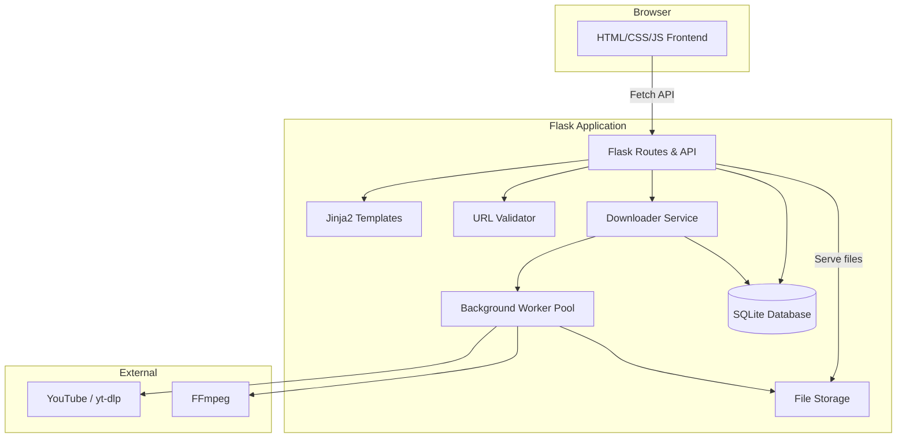
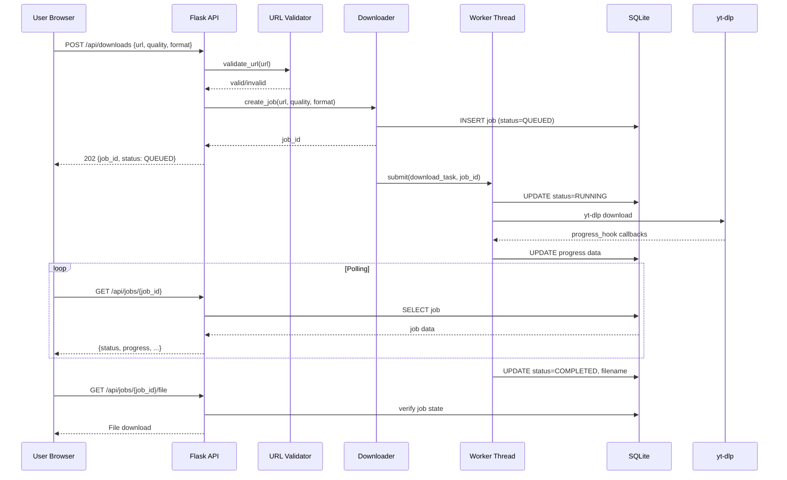

# ARCHITECTURE.md: YT-DLP Web Downloader

## 1. System Overview



## 2. Module Responsibilities

### app.py — Flask Application

- Configuration loading from environment variables.
- Database initialization and migration.
- Route definitions for all API endpoints and the dashboard.
- Request validation and error handling.
- File serving with access checks.
- Application startup and shutdown hooks.
- Worker pool initialization and cleanup.

### downloader.py — Download Service

- URL validation and normalization.
- yt-dlp Python API integration.
- Metadata extraction (title, duration, formats).
- Download execution with progress hooks.
- Background worker management (ThreadPoolExecutor).
- Job state management (create, update, query).
- Batch and playlist handling.
- File cleanup service.
- FFmpeg availability detection.

### templates/index.html — Dashboard Template

- Jinja2 template for the main dashboard.
- Semantic HTML structure.
- Single and bulk download sections.
- Job queue display area.

### static/js/app.js — Frontend Logic

- URL input validation (client-side, pre-submission).
- Fetch API calls to backend endpoints.
- Polling-based progress updates with backoff.
- DOM updates for job status, progress, errors.
- Bulk URL parsing and validation display.

### static/css/style.css — Styling

- CSS custom properties (design tokens).
- Responsive layout (mobile-first).
- Component styles.
- State-based styles (loading, error, success).
- Accessibility styles (focus, contrast).

## 3. Request/Response Flow

### Single Video Download



## 4. API Contracts

### GET /

Renders the dashboard HTML page via Jinja2.

### GET /api/health

**Response 200:**
```json
{
  "success": true,
  "data": {
    "status": "healthy",
    "ffmpeg_available": true,
    "active_jobs": 2,
    "queued_jobs": 5,
    "version": "1.0.0"
  }
}
```

### POST /api/metadata

**Request:**
```json
{
  "url": "https://www.youtube.com/watch?v=VIDEO_ID"
}
```

**Response 200:**
```json
{
  "success": true,
  "data": {
    "title": "Video Title",
    "duration": 300,
    "thumbnail": "https://i.ytimg.com/...",
    "uploader": "Channel Name",
    "formats_available": ["best", "1080p", "720p", "480p", "audio_best", "audio_mp3"]
  }
}
```

### POST /api/downloads

**Request:**
```json
{
  "url": "https://www.youtube.com/watch?v=VIDEO_ID",
  "quality": "720p",
  "format_type": "video"
}
```

**Response 202:**
```json
{
  "success": true,
  "data": {
    "job_id": "uuid-string",
    "status": "QUEUED"
  }
}
```

### POST /api/batches

**Request:**
```json
{
  "urls": [
    "https://www.youtube.com/watch?v=ID1",
    "https://www.youtube.com/watch?v=ID2"
  ],
  "quality": "720p",
  "format_type": "video"
}
```

**Response 202:**
```json
{
  "success": true,
  "data": {
    "batch_id": "uuid-string",
    "jobs": [
      {"job_id": "uuid-1", "url": "...", "status": "QUEUED"},
      {"job_id": "uuid-2", "url": "...", "status": "QUEUED"}
    ],
    "total": 2
  }
}
```

### GET /api/jobs/\<job_id\>

**Response 200:**
```json
{
  "success": true,
  "data": {
    "job_id": "uuid-string",
    "url": "https://...",
    "status": "RUNNING",
    "progress": {
      "percentage": 45.2,
      "downloaded_bytes": 15000000,
      "total_bytes": 33000000,
      "speed": 2500000,
      "eta": 7
    },
    "title": "Video Title",
    "quality": "720p",
    "format_type": "video",
    "created_at": "2026-10-20T12:00:00Z",
    "updated_at": "2026-10-20T12:00:05Z",
    "error_message": null,
    "filename": null,
    "retry_count": 0
  }
}
```

### GET /api/batches/\<batch_id\>

**Response 200:**
```json
{
  "success": true,
  "data": {
    "batch_id": "uuid-string",
    "status": "RUNNING",
    "total": 5,
    "completed": 2,
    "failed": 1,
    "running": 1,
    "queued": 1,
    "jobs": [...]
  }
}
```

### GET /api/jobs/\<job_id\>/file

**Response 200:** Binary file download with Content-Disposition header.
**Response 404:** Job not found or not completed.

### POST /api/jobs/\<job_id\>/retry

**Response 202:**
```json
{
  "success": true,
  "data": {
    "job_id": "uuid-string",
    "status": "QUEUED"
  }
}
```

### Error Response Format

```json
{
  "success": false,
  "error": {
    "code": "INVALID_URL",
    "message": "The provided URL is not a supported YouTube URL.",
    "details": {}
  }
}
```

## 5. Database Schema

### jobs table

| Column | Type | Description |
|--------|------|-------------|
| id | TEXT PRIMARY KEY | UUID job identifier |
| batch_id | TEXT | Foreign key to batches (nullable) |
| url | TEXT NOT NULL | Original YouTube URL |
| title | TEXT | Video title from metadata |
| status | TEXT NOT NULL | QUEUED, RUNNING, COMPLETED, FAILED, CANCELLED |
| quality | TEXT NOT NULL | Quality preset ID |
| format_type | TEXT NOT NULL | "video" or "audio" |
| progress_percent | REAL | Download percentage |
| downloaded_bytes | INTEGER | Bytes downloaded |
| total_bytes | INTEGER | Total file size |
| speed | REAL | Current download speed |
| eta | REAL | Estimated time remaining |
| filename | TEXT | Output filename (server-generated) |
| file_size | INTEGER | Final file size in bytes |
| error_message | TEXT | Sanitized error for display |
| retry_count | INTEGER DEFAULT 0 | Number of retry attempts |
| max_retries | INTEGER DEFAULT 3 | Maximum allowed retries |
| created_at | TEXT NOT NULL | ISO 8601 timestamp |
| updated_at | TEXT NOT NULL | ISO 8601 timestamp |

### batches table

| Column | Type | Description |
|--------|------|-------------|
| id | TEXT PRIMARY KEY | UUID batch identifier |
| status | TEXT NOT NULL | QUEUED, RUNNING, COMPLETED, FAILED |
| total_items | INTEGER NOT NULL | Number of items in batch |
| quality | TEXT NOT NULL | Quality preset for all items |
| format_type | TEXT NOT NULL | Format type for all items |
| created_at | TEXT NOT NULL | ISO 8601 timestamp |
| updated_at | TEXT NOT NULL | ISO 8601 timestamp |

## 6. Background Processing

- Uses `concurrent.futures.ThreadPoolExecutor` with configurable `max_workers` (default: 3).
- Jobs submitted to the pool after database insertion.
- Each worker thread runs yt-dlp download with progress hooks.
- Progress hooks update SQLite via thread-safe connection.
- On startup, jobs left in RUNNING state are reset to FAILED with an appropriate message.
- Queue depth is checked before accepting new jobs.

## 7. yt-dlp Integration

- Uses yt-dlp Python API (`yt_dlp.YoutubeDL`).
- No shell command construction from user input.
- Options are server-controlled, not client-supplied.
- Quality presets map to yt-dlp format selectors.
- Progress hooks convert yt-dlp callback data to job progress fields.
- Metadata extraction uses `extract_info(url, download=False)`.
- Output template uses server-generated safe filenames.
- Restricted to YouTube extractor only.

## 8. FFmpeg Dependency

- Required for video+audio stream merging (common for high-quality videos).
- Required for MP3 audio conversion.
- Availability checked at startup and reported via health endpoint.
- Missing FFmpeg produces a clear, user-friendly error for affected downloads.
- FFmpeg path can be configured via environment variable.

## 9. Security Boundaries

- URL validation: allowlist of YouTube hostnames and schemes (https only).
- SSRF: reject private IPs, loopback, link-local after DNS resolution.
- File serving: path validated against downloads directory, no traversal.
- Rate limiting: per-IP limits on download submission endpoints.
- Body size: Flask MAX_CONTENT_LENGTH configured.
- yt-dlp: no user-supplied options, extractors restricted.
- Error messages: sanitized before client response.

## 10. Configuration

All configuration via environment variables with sensible defaults:

| Variable | Default | Description |
|----------|---------|-------------|
| FLASK_ENV | development | Flask environment |
| SECRET_KEY | (generated) | Flask secret key |
| DOWNLOAD_DIR | ./downloads | Download file storage |
| DATABASE_PATH | ./ytdl.db | SQLite database file |
| MAX_CONCURRENT_DOWNLOADS | 3 | Worker pool size |
| MAX_BATCH_SIZE | 20 | Maximum URLs per batch |
| MAX_PLAYLIST_ITEMS | 50 | Maximum playlist items |
| MAX_QUEUE_DEPTH | 50 | Maximum queued jobs |
| DOWNLOAD_TIMEOUT | 1800 | Download timeout (seconds) |
| FILE_RETENTION_HOURS | 24 | Hours to keep downloaded files |
| RATE_LIMIT_PER_MINUTE | 30 | API rate limit per IP |
| MAX_CONTENT_LENGTH | 1048576 | Max request body (1MB) |
| MAX_RETRIES | 3 | Max retry attempts per job |

## 11. Deployment Assumptions

- Single-process deployment behind a reverse proxy.
- Flask development server for local development only.
- Production requires WSGI server (gunicorn) + reverse proxy (nginx).
- SQLite adequate for single-instance deployment.
- No multi-instance or distributed deployment support.
- HTTPS must be provided by reverse proxy.
